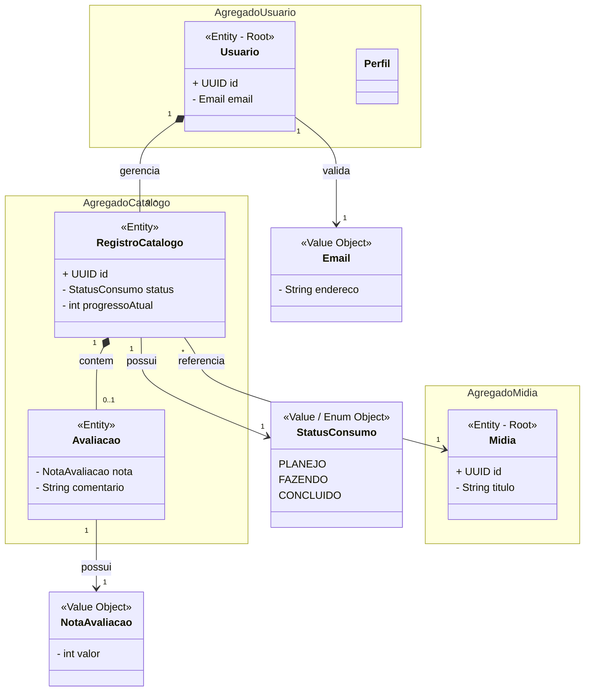

# Modelagem do Domínio: KohiTracker

## 1. Identificação do Domínio
O domínio principal do KohiTracker é a **Gestão de Catálogo Pessoal de Entretenimento**. O sistema lida com o rastreamento (tracking) do ciclo de vida de consumo de mídias e a interação social (avaliações) sobre essas obras.

## 2. Elementos do DDD

### Entidades (Possuem identidade única e ciclo de vida)
* **Usuario (Raiz de Agregação):** Entidade principal que detém a identidade de quem acessa o sistema.
* **Midia (Raiz de Agregação):** Representa a obra em si (Jogo, Filme, Livro). Tem identidade global e é imutável do ponto de vista do usuário comum.
* **RegistroCatalogo:** Entidade associativa que controla a relação entre um usuário e uma mídia específica.

### Objetos de Valor (Value Objects - Não possuem identidade, definidos por seus atributos)
* **StatusConsumo:** Enumeração que define o estado atual (Planejo, Fazendo, Concluído, Abandonado). Se o status mudar, o objeto de valor é substituído.
* **NotaAvaliacao:** Objeto que garante que a nota sempre estará dentro de um limite válido (ex: 1 a 10).
* **Email:** Valida a formatação correta de e-mail na criação do usuário, encapsulando a regra de validação.

### Repositórios (Abstração de acesso a dados)
* **IUsuarioRepository:** Busca, salva e atualiza dados do usuário.
* **IMidiaRepository:** Consulta o catálogo global de mídias.
* **IRegistroCatalogoRepository:** Persiste o progresso e o status das mídias na biblioteca do usuário.

### Serviços de Domínio
* **ServicoAvaliacaoMidia:** Serviço necessário porque a regra de calcular a nova nota média global de uma mídia envolve múltiplas avaliações de diferentes usuários. Não caberia apenas na entidade `Usuario` nem apenas em `Midia`.

## 3. Principais Regras de Negócio (Revisão da Sprint 2)
1. **Unicidade de Registro:** Um `Usuario` não pode criar mais de um `RegistroCatalogo` para a mesma `Midia`. Modificações ocorrem atualizando o registro existente.
2. **Pré-requisito de Avaliação:** Para adicionar uma `Avaliacao`, o usuário obrigatoriamente precisa ter a obra no seu `RegistroCatalogo` com um status diferente de "Planejo" (não se avalia o que ainda não foi consumido).

## 4. Diagrama de Domínio (DDD)

